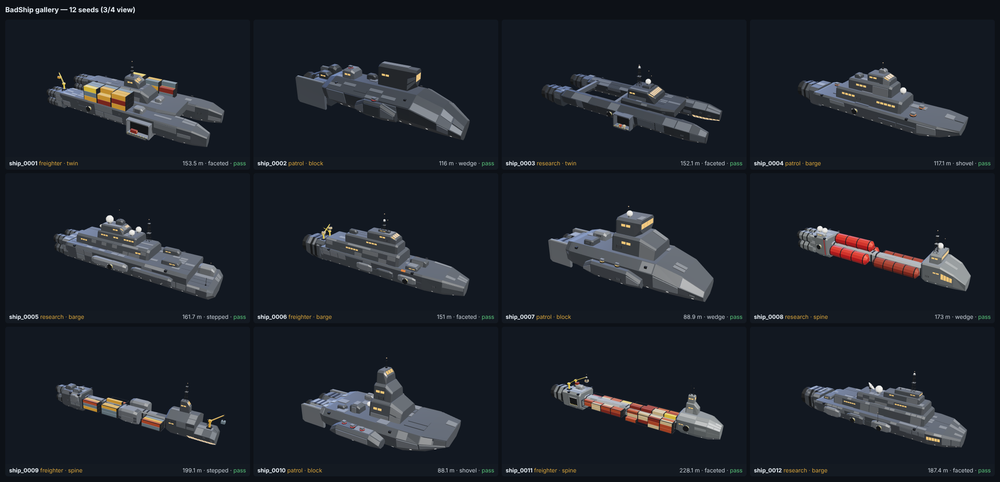
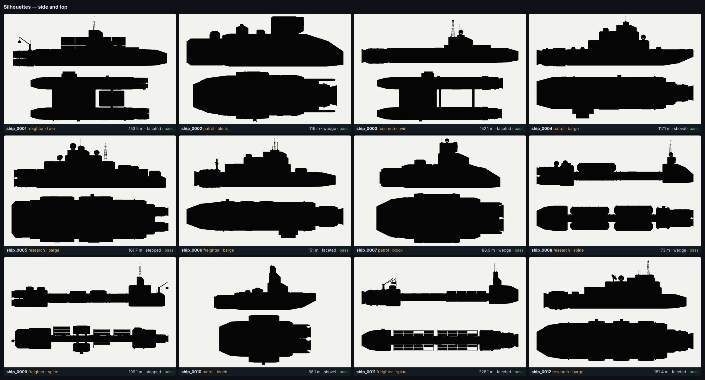

# BadShip

A standalone, engine-agnostic **procedural generator for industrial spaceship exteriors**: blocky, chunky, modular
working ships built from a seed. *Less elegant star yacht, more hardworking flying industrial facility.*

This is the experiment for a possible future **NoorShip** bench in [NoorMD](https://github.com/badsadcode/NoorMD). It is
written in C# (.NET 10) with no dependencies beyond the base library, following the conventions of NoorMD's NoorForm:
Y up, metres, recipe + seed, hand-written GLB, and checks with the Khronos validator. It does **not** reference NoorMD.
The original brief from Bad Ideas Works is in [`docs/brief/`](docs/brief/) (and the zip at the root).



The faceted hull form with the Thalassa-style wraparound prow glass, and an open hangar bay:




## Quick start

```bash
dotnet run --project src/BadShip.Cli -- generate --seed 42 --archetype research --out out/ship
dotnet run --project src/BadShip.Cli -- gallery --count 12 --out out/gallery
dotnet run --project src/BadShip.Cli -- recipe out/ship/ship_42.recipe.json --out out/again
dotnet run --project src/BadShip.Cli -- stress --count 1000
dotnet test
```

Options: `--archetype freighter|research|patrol`, `--family barge|spine|twin|block`, `--length <m>`,
`--palette gunmetal|naval|offwhite|slate`, `--detail low|medium|high`, `--name`. Anything left out is chosen from the seed.

Each ship produces four files:

| File | Contents |
|---|---|
| `ship.glb` | glTF 2.0 binary: one named node per module, nested by attachment, pivots at module centres, one material per role, semantic `extras`, functional markers as empty nodes (+Z along the marker direction) |
| `ship.recipe.json` | the recipe (seed, archetype, ...) plus every resolved choice; regenerates the identical ship with the same generator version |
| `ship.metadata.json` | axes, bounds, module tree with bounds, markers (engines with exhaust vectors, docking ports, bridge, sensors, hardpoints, cargo doors, lights), interior envelopes, materials |
| `ship.validation.json` | pass / warn / error with explained issues and metrics |

### Looking at the ships

```bash
cd tools/render && npm install
node render.mjs ../../out/gallery           # contact_sheet.png + silhouettes.png
node closeup.mjs ../../out/gallery ship_0001 # four views of one ship
cd ../glb-validate && npm install && node validate.mjs ../../out/gallery   # Khronos glTF validator
```

To make the interactive 3D gallery page (all ships embedded, orbit, shading modes, markers, part inspection):

```bash
node tools/hangar/build.mjs out/gallery out/hangar.html
```

The renderer uses three.js in the headless Chromium that comes with Playwright. Any glTF viewer works too
(Blender, Godot, <https://gltf-viewer.donmccurdy.com>).

## How it works

```text
recipe + seed
  → plan          archetype, hull family, proportions, prow, bridge, tiers, engines, payload, palette
  → primary       the hull family lays out 2–5 big lofted masses and registers decks and side faces
  → engines       engineering bay + grid of pods/nacelles, nozzles, glowing cores, exhaust markers
  → superstructure stacked tiers, the top one is the bridge (windows, bridge marker, habitable envelope)
  → equipment     machinery blocks, radomes, dishes, lattice masts, cranes, containers, docking collars,
                  cargo bays, hardpoint placeholders; equipment inside an exhaust or docking corridor is dropped
  → details       plates, vents, running lights, accent stripes, RCS thrusters (".details" child nodes)
  → validate      attachment tree, exhaust and docking clearance, mesh sanity, budgets
  → export        GLB + recipe + metadata + validation
```

- **One primitive does most of the work.** `Profile` is a rectangle that can taper and has chamfered top and bottom
  corners; a `Loft` skins a few profiles along +Z. That covers boxes, chamfered boxes, trapezoid prisms, wedges, sloped
  prows and stepped decks (two rings at the same Z make a step). Faces have fixed indices, so windows, bays and plates
  are placed as `(u, v)` rectangles on named faces and a surface registry keeps them from overlapping.
- **Hull forms:** `slab` (upright sides) or `faceted` (the Thalassa look: wide shallow top facets set by
  `Profile.TopRun`, a sharp shoulder crease and a deep inward-sloping lower hull). Faceted hulls get long faceted
  noses with a wraparound band of observation glass across the lower prow facets.
- **Hull families** (`HullFamilies.cs`): `barge` (one broad stepped hull, like the Thalassa reference), `spine`
  (command block + payload segments on a keel + engine block, with visible gaps), `twin` (two hulls under a bridge
  deck, cross girders and an optional slung cargo pod), `block` (compact armoured brick with sponsons and shrouded engines).
- **Archetypes** choose the family weights, prow styles and equipment: `freighter` (cranes, containers, bays, docks),
  `research` (radomes, dishes, lattice mast, observation windows, lab pods), `patrol` (armour, hardpoint placeholders).
- **Determinism:** a hand-written xoshiro256** RNG with an independent stream per stage (`plan`, `silhouette`,
  `equipment`, `details`, `look`), so a palette or detail change never moves the hull. `ShipGenerator.Version` must
  be bumped whenever the same recipe would give a different ship.
- **Coordinates:** metres, +Y up, +Z forward (bow), +X port, right-handed; the main hull is centred on the origin.
- **Materials by role:** `hull_main`, `hull_secondary`, `dark_mechanics`, `glass`, `emissive_light`, `nav_red`,
  `engine_glow`, `hazard`, `accent`, `radome`, `cargo_a/b/c`. Each is one replaceable glTF material. UVs are
  box-projected in world space at 4 m per tile (they are exported but no textures are attached yet).

## Status (v0.2.0, phase A + the Thalassa pass)

- 4 hull families × 3 archetypes × 2 hull forms, 5 prow styles, 3 bridge styles, 5 engine layouts, 2 engine styles, 4 palettes.
- Open hangar bays (lit alcove with depth, gantry, hazard sill, vehicle or crates, railed platform) built from
  closed boxes, plus flat cargo doors where a hangar doesn't fit.
- 3000 consecutive seeds: 0 validation errors, 0 warnings; about 4.5 ms and roughly 4.5k triangles per ship.
- Exports pass the Khronos glTF validator with 0 errors and 0 warnings (infos only: UVs unused without textures).
- 19 unit tests: determinism, stage independence, validation over hundreds of seeds, recipe round trip, GLB structure.

**Known limitations:** collision and clearance tests use bounding boxes (conservative); no LODs or collision proxies
yet; no textures (greybox with material roles); not yet tested in Blender or Godot; no interactive editor (CLI +
renders only); no locking or rerolling of individual modules yet.

**Next (phase B/C ideas):** a viewer with parameter controls, module locking and rerolls; LODs and collision hulls;
hull livery (name, logo, mission text decals); more archetypes (mining, tender) and macro families (offset hauler, multi-deck brick); radiators, booms and gantries;
a damage pass; and then the self-contained NoorShip design doc for NoorMD.

## Layout

```text
src/BadShip.Core/     Geometry (Mesh, Profile/Loft, Shapes), Model (Ship, Module, Marker),
                      Generation (Planner, HullFamilies, Parts, Payload, Equipment, Details, Palette, Rng),
                      Validation (ShipValidator), Export (GlbWriter, ShipFiles)
src/BadShip.Cli/      the badship command
tests/BadShip.Tests/  xUnit tests
tools/render/         three.js + Playwright contact sheets and close-ups
tools/glb-validate/   Khronos glTF validator runner
docs/brief/           the original handoff package
```
