# BadShip

A standalone, engine-agnostic **procedural generator for industrial spaceship exteriors**: blocky, chunky, modular
working ships built from a seed. *Less elegant star yacht, more hardworking flying industrial facility.*

This is the experiment for a possible future **NoorShip** bench in [NoorMD](https://github.com/badsadcode/NoorMD). It is
written in C# (.NET 10) with no dependencies beyond the base library, following the conventions of NoorMD's NoorForm:
Y up, metres, recipe + seed, hand-written GLB, and checks with the Khronos validator. It does **not** reference NoorMD.
The original brief from Bad Ideas Works is in [`docs/brief/`](docs/brief/) (and the zip at the root).

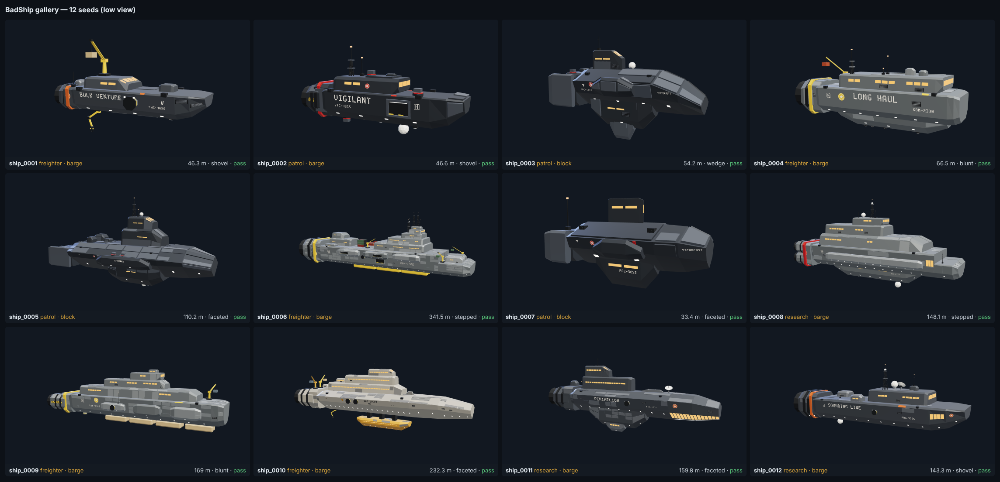

**Fleets.** Three factions, eight ships each, at true scale. Paint comes from the operator; architecture from the yard
that built each ship (Halvorsen's orange engine collars and square prows, Meridian's faceted glass noses and gondolas,
Korsak's armoured wedges and keels):

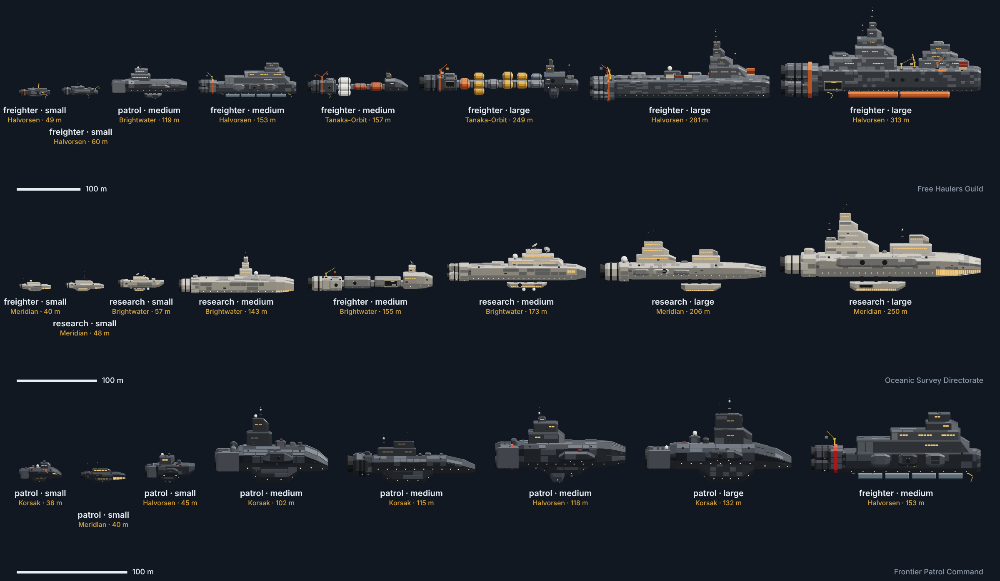

The faceted hull form with the Thalassa-style wraparound prow glass, and an open hangar bay:

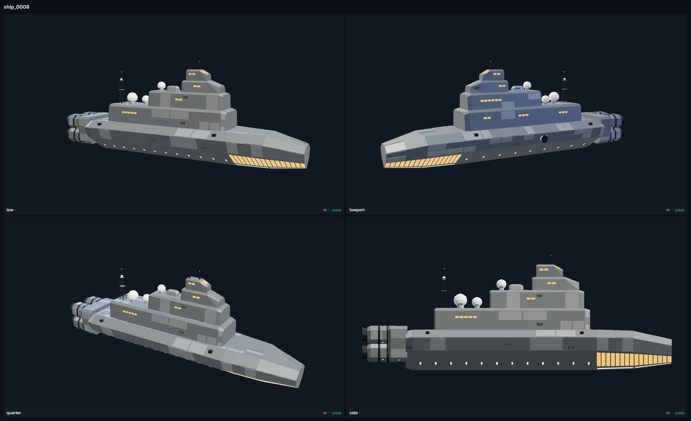
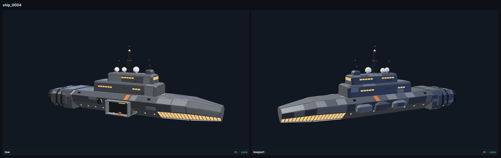

Below the hull: an inverted two-step keel, and slung pods with a hanging sensor dome:

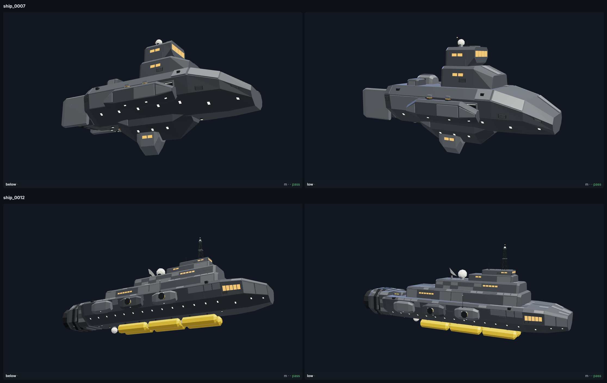

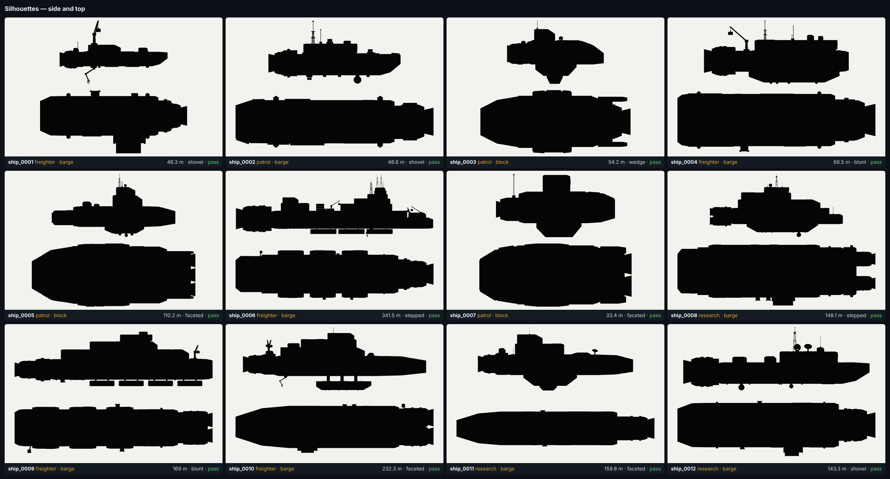

## Quick start

```bash
dotnet run --project src/BadShip.Cli -- generate --seed 42 --archetype research --out out/ship
dotnet run --project src/BadShip.Cli -- gallery --count 12 --out out/gallery
dotnet run --project src/BadShip.Cli -- recipe out/ship/ship_42.recipe.json --out out/again
dotnet run --project src/BadShip.Cli -- stress --count 1000
dotnet test
```

**Pin choices, reroll stages.** `--set` fixes any plan choice and lets the seed pick the rest; `--stage-seed` replaces
the seed for one stage only, so a hull you like stays put while its equipment, detail or colours change:

```bash
dotnet run --project src/BadShip.Cli -- generate --seed 7 --archetype research --set hull_form=faceted,prow=wedge,tiers=4,engines=2x2
dotnet run --project src/BadShip.Cli -- generate --seed 7 --stage-seed equipment=3,look=8
dotnet run --project src/BadShip.Cli -- variants --seed 7 --stage equipment --count 8 --out out/variants
dotnet run --project src/BadShip.Cli -- generate --seed 3 --faction survey --manufacturer meridian --size large
dotnet run --project src/BadShip.Cli -- fleet --faction haulers --count 8 --seed 3 --out out/fleet_haulers
node tools/render/lineup.mjs out/fleet_haulers   # true-scale lineup.png
```

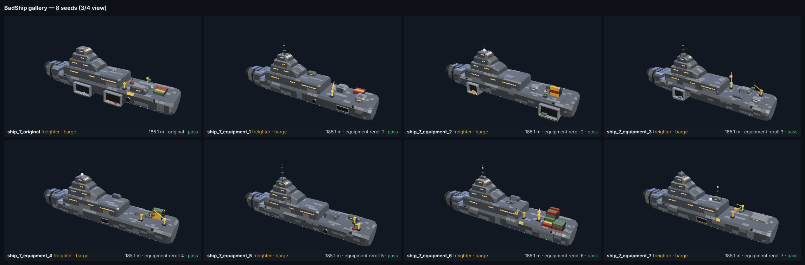

Options: `--archetype freighter|research|patrol|fighter`, `--family barge|spine|twin|block|fighter`, `--length <m>`,
`--palette gunmetal|naval|offwhite|slate`, `--detail low|medium|high`, `--name`. Anything left out is chosen from the seed.

Each ship produces four files:

| File | Contents |
|---|---|
| `ship.glb` | glTF 2.0 binary: one named node per module, nested by attachment, pivots at module centres, one material per role, semantic `extras`, functional markers as empty nodes (+Z along the marker direction) |
| `ship.recipe.json` | the recipe (seed, archetype, ...) plus every resolved choice; regenerates the identical ship with the same generator version |
| `ship.metadata.json` | axes, bounds, module tree with bounds, markers (engines with exhaust vectors, docking ports, bridge, sensors, hardpoints, cargo doors, lights), interior envelopes, materials |
| `ship.validation.json` | pass / warn / error with explained issues and metrics |
| `ship.lod1.glb`, `ship.lod2.glb` | levels of detail: LOD1 drops surface detail and small equipment, LOD2 keeps only the primary masses |
| `ship.collision.glb` | collision as convex pieces, one node each: every straight loft segment of the hull masses, a box for anything else |

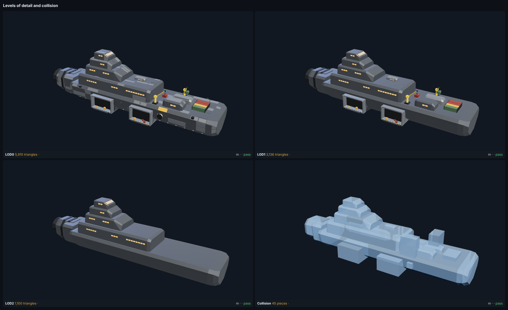

### Looking at the ships

```bash
cd tools/render && npm install
node render.mjs ../../out/gallery           # contact_sheet.png + silhouettes.png
node closeup.mjs ../../out/gallery ship_0001 # four views of one ship
cd ../glb-validate && npm install && node validate.mjs ../../out/gallery   # Khronos glTF validator
```

To make the interactive 3D gallery page (all ships embedded, orbit, shading modes, markers, part inspection):

```bash
node tools/hangar/build.mjs out/gallery out/hangar.html
```

**The Shipyard** (live generator in the browser): `src/BadShip.Web` compiles the same generator to WebAssembly
(about 5 MB, trimmed), and `tools/shipyard/shipyard.html` drives it with seeds, options, per-stage rerolls and a 3D
viewer. A ship takes roughly 100–300 ms in the browser after a one-second warm-up.

```bash
tools/shipyard/build.sh            # out/shipyard: index.html + framework/
cd out/shipyard && python3 -m http.server
```

**Ship codes and versioned snapshots.** Every ship has a code such as `v0p4p0-s3-fsurvey-mmeridian-zlarge-qe5`
(generator version, seed, then only the settings that differ from auto; see `Export/ShipCode.cs` for the keys). The
CLI prints it after every `generate` and rebuilds from it with `--code`; the Shipyard keeps it in the page address,
so a link names one exact ship. Each released generator lives in the Shipyard under `framework/<version>/` and a code
always opens with the version that made it, so shared ships never change under people's feet. To release a version:

1. Bump `ShipGenerator.Version` (whenever the same recipe would give a different ship).
2. Add the version to `VERSIONS` in `tools/shipyard/shipyard.html` (newest last).
3. Run `tools/shipyard/build.sh` and publish only the new `framework/<version>/` folder with the page; keep the old
   folders where they are.

**Godot import test** (`tools/godot-test/`): a minimal Godot 4 project that imports exported ships with Godot's own
glTF importer and checks every ship two ways, as an imported scene (editor) and loaded at runtime with
`GLTFDocument` (a game loading generated ships while it runs): bounds against our metadata, exact triangle counts,
one node per module (names as Godot sanitises them), materials (with emissive engine glow), node extras arriving as
Godot metadata, LOD files getting lighter, and every collision piece turning into a `ConvexPolygonShape3D`.

```bash
GODOT=/path/to/godot tools/godot-test/run.sh out/gallery      # writes tools/godot-test/report.json
xvfb-run godot --path tools/godot-test --rendering-driver opengl3 --script res://showcase.gd -- ship_0005 ship_0008
```

Result with Godot 4.4.1: all 12 gallery ships (48 files) pass both paths with 0 failures, including the livery
decal texture. The headless editor
import prints `Parameter "t" is null` once per file; that comes from the dummy renderer's asset-preview thumbnail
(a hand-made one-triangle GLB triggers it too), not from our files. Rendered by Godot itself:

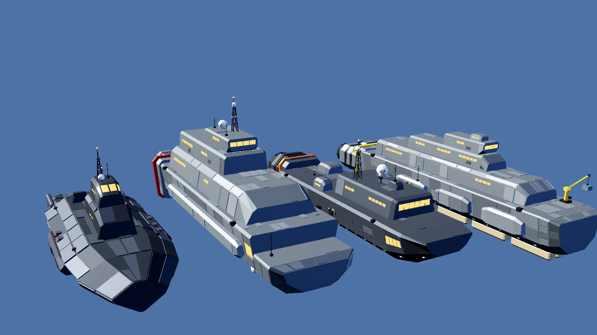
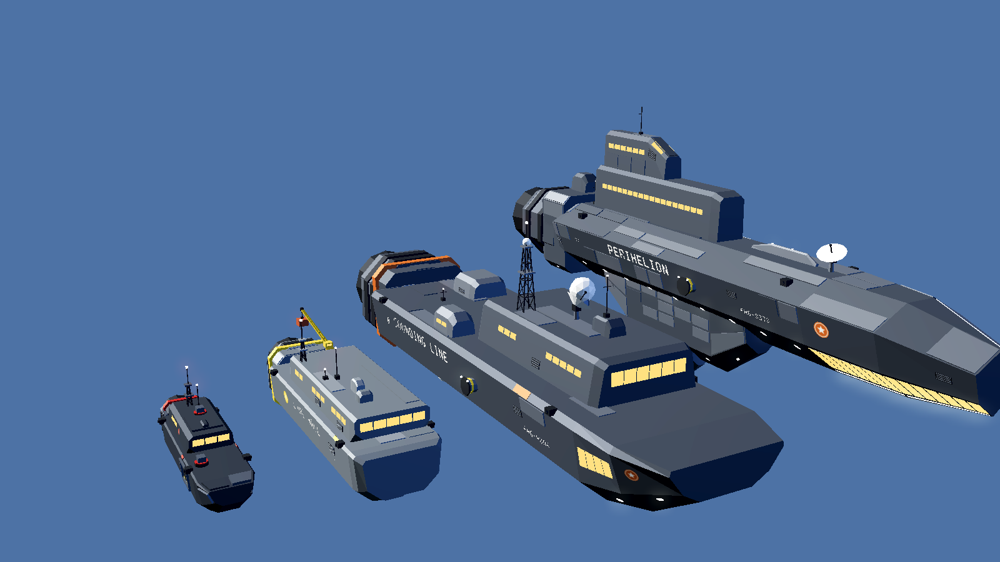

The renderer uses three.js in the headless Chromium that comes with Playwright. Any glTF viewer works too
(Blender, Godot, <https://gltf-viewer.donmccurdy.com>).

## How it works

```text
recipe + seed
  → plan          archetype, hull family, proportions, prow, bridge, tiers, engines, payload, palette
  → primary       the hull family lays out 2–5 big lofted masses and registers decks and side faces
  → engines       engineering bay + grid of pods/nacelles, nozzles, glowing cores, exhaust markers
  → superstructure stacked tiers, the top one is the bridge (windows, bridge marker, habitable envelope)
  → equipment     machinery blocks, radomes, dishes, lattice masts, cranes, containers, docking collars,
                  cargo bays, hardpoint placeholders; equipment inside an exhaust or docking corridor is dropped
  → details       plates, vents, running lights, accent stripes, RCS thrusters (".details" child nodes)
  → validate      attachment tree, exhaust and docking clearance, mesh sanity, budgets
  → export        GLB + recipe + metadata + validation
```

- **One primitive does most of the work.** `Profile` is a rectangle that can taper and has chamfered top and bottom
  corners; a `Loft` skins a few profiles along +Z. That covers boxes, chamfered boxes, trapezoid prisms, wedges, sloped
  prows and stepped decks (two rings at the same Z make a step). Faces have fixed indices, so windows, bays and plates
  are placed as `(u, v)` rectangles on named faces and a surface registry keeps them from overlapping.
- **Hull forms:** `slab` (upright sides) or `faceted` (the Thalassa look: wide shallow top facets set by
  `Profile.TopRun`, a sharp shoulder crease and a deep inward-sloping lower hull). Faceted hulls get long faceted
  noses with a wraparound band of observation glass across the lower prow facets.
- **Below the hull** (`Ventral.cs`, `EquipmentVentral.cs`): one ventral structure per ship, `keel` (inverted
  stepped terraces buried into the hull's lower chamfers, sometimes two steps), `gondola` (a pod on pylons with open
  space above it; research ships get an observation gondola) or `pods` (tanks or cargo pods slung on short pylons),
  plus hanging equipment on underside decks: sensor domes, a utility claw, belly doors, downward docking ports with
  their corridors, ventral hardpoints and floodlights. Ventral structures have their own `ventral` stage seed.
- **Manufacturers, factions and size classes** (`Design.cs`): a *manufacturer* is a design language (hull family
  and form preferences, chamfers and taper, prow and bridge styles, engine style, layout and bay size,
  superstructure steps, sensors, window style, side modules, plating, underside preference and a signature element:
  `dorsal_ridge`, `accent_bands` or `engine_collar`). Presets: Halvorsen Heavy Works, Meridian Survey Yards, Korsak
  Arsenal, Tanaka-Orbit Logistics, Brightwater Cooperative; `yard-N` makes a procedural yard. A *faction* is an
  operator: paint, the roles and sizes it fields and the yards it buys from (Free Haulers Guild, Oceanic Survey
  Directorate, Frontier Patrol Command, Kessler Belt Mining Union, independent, `faction-N`). *Size classes* have
  their own rules: small craft are stubbier with one big engine or a pair, one or two tiers and fewer, relatively
  larger parts; large ships get extra tiers, a second superstructure island, longer spines and more equipment.
- **Livery** (`Livery/`): optional markings drawn into one decal sheet per ship (a PNG embedded in the GLB): the
  ship's name in a blocky stencil font, a registration with the operator's prefix (FHG, OSD, FPC, KBM, IND),
  the faction emblem in its accent colour, the manufacturer's mark, and hazard chevrons on the engine pods. Decals are
  alpha-cutout quads placed on flat hull and superstructure faces, upright and reading left to right from either
  side, kept clear of windows, bays and anything bolted on, shrunk to fit but never below a readable size. Letters
  are dark on light hulls and light on dark ones. `--livery none` (or `livery: "none"`) gives clean ships; `--name`
  paints a name of your own. The image tools (PNG writer, rasteriser, stencil font) are plain C#.

  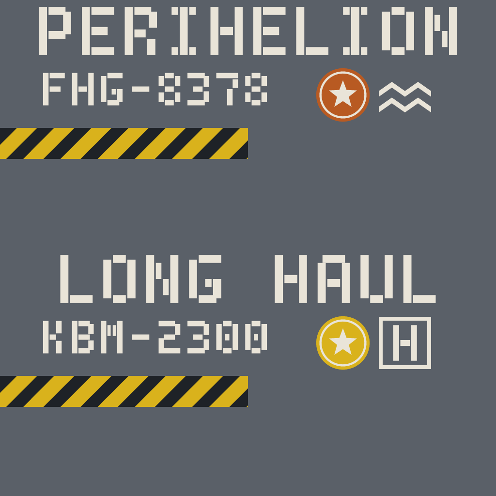
- **Condition** (`Damage.cs`): `--condition damaged|derelict` keeps the ship's identity (same seed, hull, layout, name)
  and adds wear on its own random stream. *Damaged*: jagged hull breaches (heat-discoloured ring, scorch, black hole,
  exposed ribs, plates peeled outwards, sometimes embers), stripped frame sections, one engine cold, some masts and
  antennas snapped to stumps or leaning, some sections dark. *Derelict*: more and bigger breaches, every light out,
  engines cold, faded paint and livery, detachable cargo and container stacks gone, and drifting debris plates
  (flagged detachable, kept out of the ship's bounds). Intact ships are unchanged.

  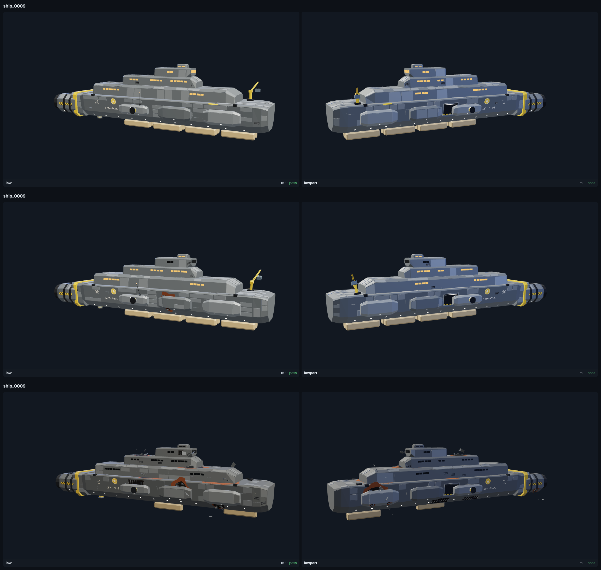
- **Hull families** (`HullFamilies.cs`): `barge` (one broad stepped hull, like the Thalassa reference), `spine`
  (command block + payload segments on a keel + engine block, with visible gaps), `twin` (two hulls under a bridge
  deck, cross girders and an optional slung cargo pod), `block` (compact armoured brick with sponsons and shrouded engines).
- **Archetypes** choose the family weights, prow styles and equipment: `freighter` (cranes, containers, bays, docks),
  `research` (radomes, dishes, lattice mast, observation windows, lab pods), `patrol` (armour, hardpoint placeholders).
- **Determinism:** a hand-written xoshiro256** RNG with an independent stream per stage (`plan`, `silhouette`,
  `equipment`, `details`, `look`), so a palette or detail change never moves the hull. `ShipGenerator.Version` must
  be bumped whenever the same recipe would give a different ship.
- **Coordinates:** metres, +Y up, +Z forward (bow), +X port, right-handed; the main hull is centred on the origin.
- **Materials by role:** `hull_main`, `hull_secondary`, `dark_mechanics`, `glass`, `emissive_light`, `nav_red`,
  `engine_glow`, `hazard`, `accent`, `radome`, `cargo_a/b/c`. Each is one replaceable glTF material. UVs are
  box-projected in world space at 4 m per tile (they are exported but no textures are attached yet).

### Fighters (v0.7.0, more forms in v0.8.0)

`--archetype fighter` builds small craft in a stealth, hard-surface language (the "badlook"): flat facets with sharp
creases, chines, sides that lean inwards as they rise (tumblehome, the opposite of a boat hull), arrowhead and
hunched silhouettes, cockpits blended into the hull (a faceted glass canopy or an armoured brow with glass slits),
flat slit exhausts with splitter vanes, knife-edged canted fins, sawtooth trailing edges, and thin glowing accent
lines along the chines. The operator's paint is pushed dark and matte.

| Form | What it is | Sizes |
|---|---|---|
| `dart` | sleek arrowhead, cranked delta wings with serrated trailing edges, optional canards and ventral fins | mostly small/medium |
| `wedge` | one flat faceted delta: the craft is its own wing; V-tails and sawtooth points at the rear | all |
| `brick` | bulky armoured gunship with a hunched brow and beak, chin guns, stub wings with gun pods, optional side nacelles | mostly large |
| `fork` | a cockpit body between two long forward prongs with guns at their tips | medium/large |
| `hammer` | a narrow armoured neck carrying a wide head block (cockpit slits and guns in the head), swept tail stubs | all |
| `twinboom` | two blocky booms with the engines and tails, a crossbar wing and a cockpit pod between them | medium/large |
| `brawler` | short and stout: shoulder-mounted engine blocks, layered flank armour, drooped gun stubs, chin guns | small/medium |

Two dials run across every form, so fighters are not all needles or all bricks: **bulk** moves the cross-section
from the knife-edged stealth shape towards an armoured chamfered block (never a plain box: the sides keep a little
lean and the top keeps its facets), and the **nose** is a needle `point`, a flat `chisel` tip or a `blunt` armoured
face (`--set prow=chisel`).

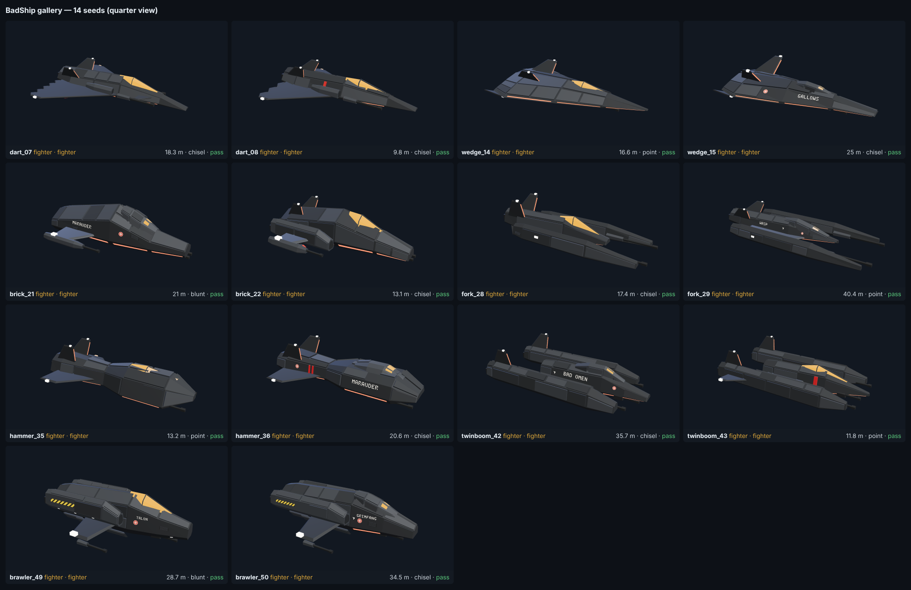

**Wings (v0.9.0).** Any form except the wedge (its body is the wing) and the fork (its prongs do that job) can take
a wing style instead of its own: `swept` blades, `forward`-swept blades, an `x` (two up, two down, guns on every tip),
`gull` (out, then bent down and forward at a knee), `layered` (stacked overlapping plates with guns underneath),
`pods` (stubs with engine pods on the tips: more exhausts), or `asym` (one long blade, one stub carrying a lance
cannon). A span factor from stubby (0.5) to huge (1.8) scales them. `--set wings=gull,wing_span=1.6`; the Shipyard
has both as menus. Wings use their own random stream, so changing them never moves the body.

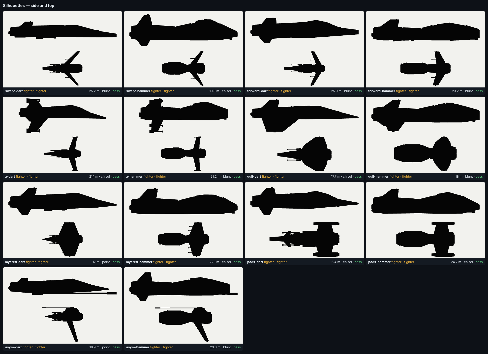

Sizes: small 8–15 m, medium 15–26 m, large 26–45 m (gunships). Pin a form with `--set hull_form=wedge`; cockpit with
`bridge=canopy|slit`, engines with `engines=1x1|2x1|3x1` and `engine_style=slit|pod`. Guns and missile
racks carry `hardpoint` markers; the cockpit carries the `bridge` marker. Surface detail, damage and livery work at
fighter scale. The Frontier Patrol fields fighters often; other factions only escort.

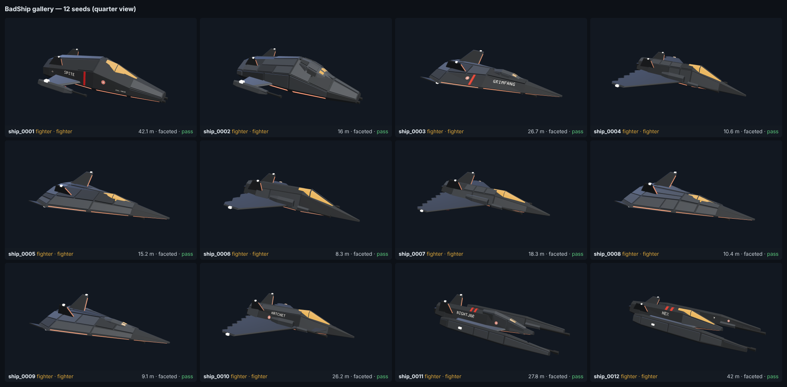

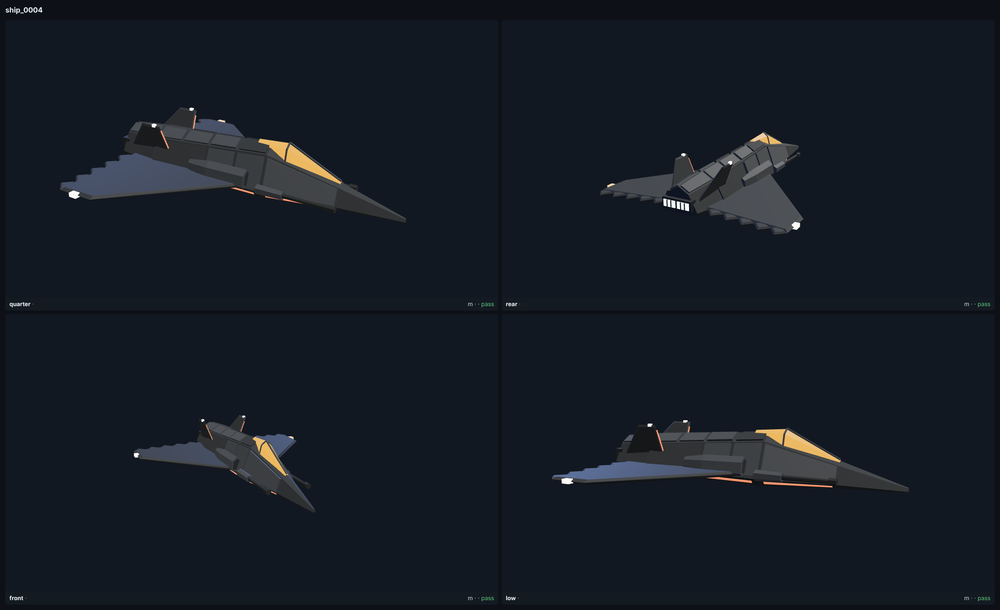

### Citadels (v0.10.0)

`--archetype citadel` builds flying fortresses, 260–820 m long: a tall armoured hull with buttress ribs down the
flanks, broadside gun decks and rows of lit windows between the ribs, hangar mouths in the flanks, a stepped keep
rising from the deck (each tier narrower and set back, watch towers with stepped caps and lit galleries, a glazed
command bridge with masts on top), big turrets along the spine (some raised to fire over the others), small towers
along the deck edges, and a wall of engine nozzles at the stern. Pin choices with `--set`: `prow=ram|blade|bastion`
(a dagger ram that reaches below the keel line, a long low knife, or armoured terraces), `bridge=aft|mid` (where the
keep stands), `tiers=2..7`, `engines=2x2|3x2|4x2|3x3`, `ventral=keel|blades|undercroft` (a keel, blades and spikes,
or an inverted stepped fortress below), `hull_form=slab|faceted`. Markers: `bridge`, `hardpoint` (turrets and bow
guns), `broadside`, `hangar`, `engine_exhaust`, `sensor`. About 15–21k triangles.

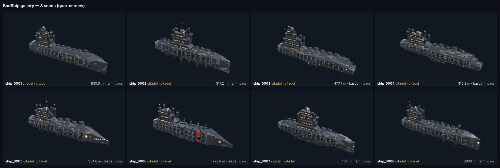

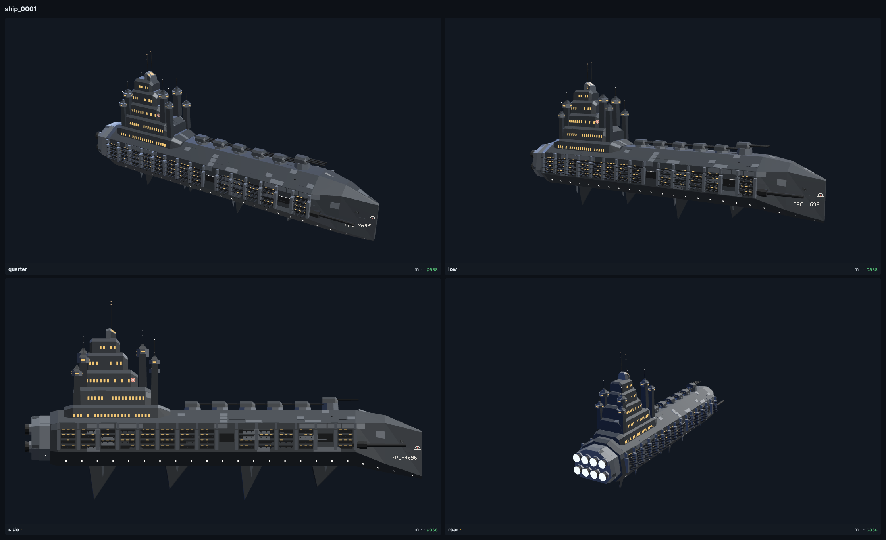

### Colour schemes and the kit pass (v0.11.0)

`--palette` now also takes the schemes from the hull concept sheets: `industrial` (dark grey, hazard yellow),
`military` (charcoal, red), `civilian` (clean white-grey, blue), `research` (white, strong blue), `stealth`
(near-black, cyan glow), `pirate` (rust and scavenged mismatched plates) and `luxury` (glossy white, gold). These fix
their own accent and finish; industrial, military, civilian, research and luxury wear it in wide bands across the
hull masses, pods and superstructure.

The kit pass adds original parts in the categories of a hard-surface kit to every ship (not fighters or citadels,
which carry their own): stern winglets at the chine, ribbed heat-radiator panels standing off the flanks, point-defence
turrets with twin barrels, long tanks strapped along the flanks, pipe runs with brackets and elbows, and clusters of
machinery blocks on the decks. Silhouette parts check their clearances and are dropped from exhaust and docking
corridors; surface parts respect windows, bays and markings.

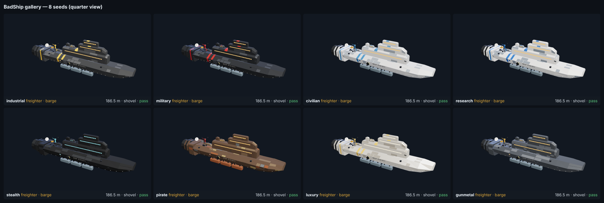

### Industrial ships (v0.12.0)

`--archetype industrial` builds work ships, 60–360 m: a chunky hull with a blunt work face (hazard bands and
floodlights), the shared engines, bridge tiers, equipment and kit, and the tool that tells you the job
(`--set payload=...`, the **Job** menu in the Shipyard):

- `drill`: a stepped drill head with spiral rings of teeth on a collar, ore hoppers on deck fed by a conveyor.
- `refinery`: a tank farm, spheres, chimney stacks with a hot glow and a pipe rack on deck; a gas scoop at the bow.
- `crane`: a lattice crane boom over the bow with an A-frame, backstay and hook, a gantry over the deck, girder
  stacks, and a work cradle at the bow.
- `salvage`: hydraulic claw arms (one or two pairs) reaching from the bow, scrap bins heaped with junk.

Tools carry `tool` markers (and `crane_hook`, `vent`, `floodlight`). Most industrial ships wear the industrial
scheme unless a palette is asked for; the Kessler Belt Mining Union fields them most.

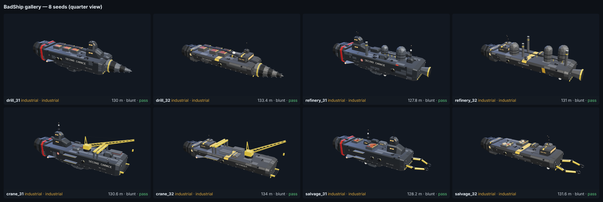

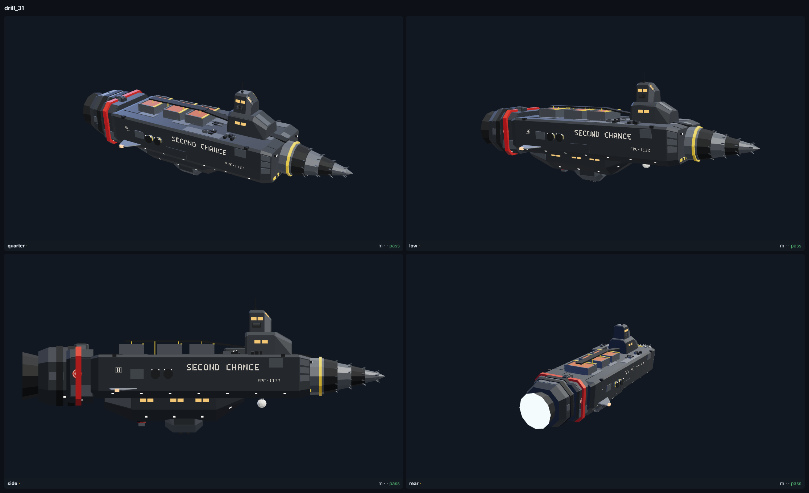

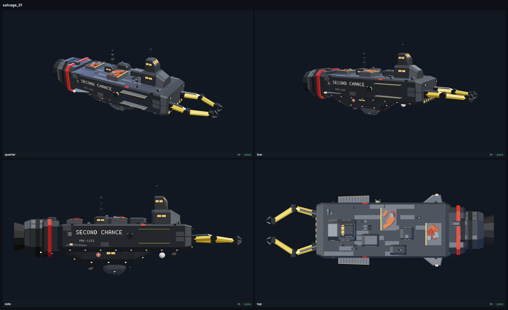

### Utility craft (v0.13.0)

`--archetype utility` builds the vans and pickups of space, 14–36 m: a boxy chamfered cab with big wraparound
windows on a sloped windscreen, a body behind it, four landing legs with pads (`landing_pad` markers), headlights, a
roof mast, and a job (`--set payload=...`, the **Job** menu):

- `runabout`: compact, engine pods on short pylons, a roof light bar.
- `mule`: a low open cargo bed with rails, a tailgate and strapped containers; an engine block at the back.
- `shuttle`: a long passenger cabin with a row of windows, side doors (`hatch` markers) and a roof docking hatch.
- `pioneer`: bolt-on side modules, a roof rack with crates, a small dish, engine pods and sturdier legs.

Shuttles often wear the civilian scheme, mules and pioneers the industrial one. About 1.2–1.5k triangles.

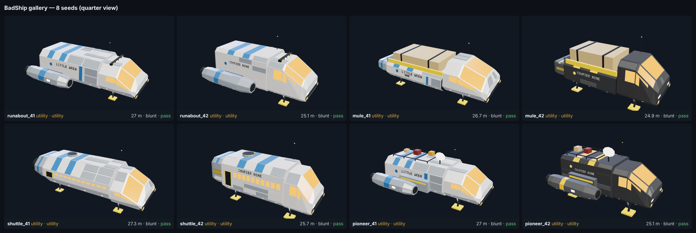

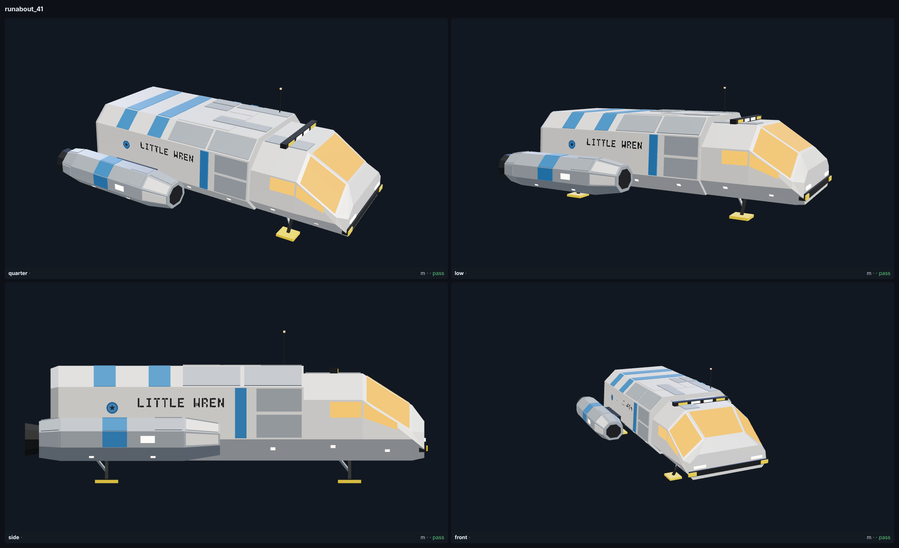

### Ring ships and the Gyre (v0.14.0)

`--archetype ring` builds a slim spine hull (the shared hull body, prow, engines and bridge) carrying big chamfered
rings on spokes from a collar round the hull, 60–320 m. Jobs (`--set payload=...`): `science` (one ring with a
window band), `expedition` (twin rings fore and aft) and `habitat` (one huge ring covered in rows of lit windows,
six spokes). Rings carry `ring_hub` markers. Decks, the bridge, the underside structure, equipment, kit and markings
keep clear of the rings. Science ships often wear the research scheme, habitats the civilian one.

The fighters gain an eighth form, `gyre`: a cockpit body between two big ducted ring engines on short arms, with fan
hubs and stator vanes glowing inside the ducts.

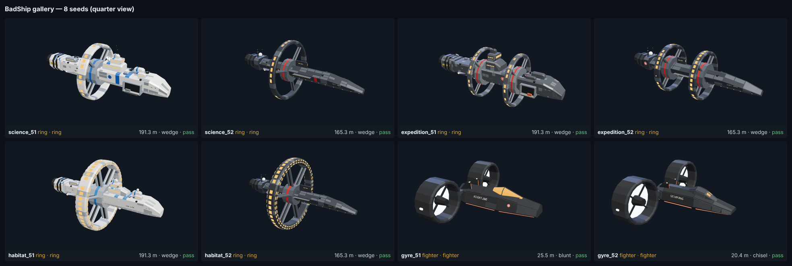

### Civilian ships (v0.15.0)

`--archetype civilian` (`--set payload=...`): `liner` (long and sleek, three bands of passenger windows down each
flank, lifeboat pods, a long promenade tier with a glass roof and a glass dome; often in the luxury or civilian
scheme), `medical` (a white-and-teal hospital ship: a ward block with our own medical symbol, a pulse line in a ring,
on its sides and roof, a lit triage door, floodlights and a teal band along the hull; the red cross is a protected
emblem, so it is not used) and `explorer` (an observation dome, a big survey dish on a mast and long sensor booms
reaching ahead of the bow). New `medical` colour scheme. Markers: `observation_deck`, `hatch`, `floodlight`, `sensor`.

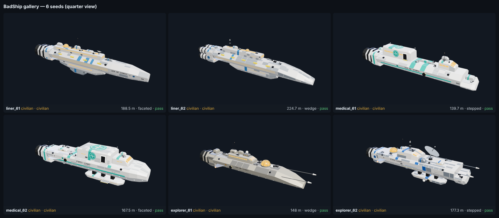

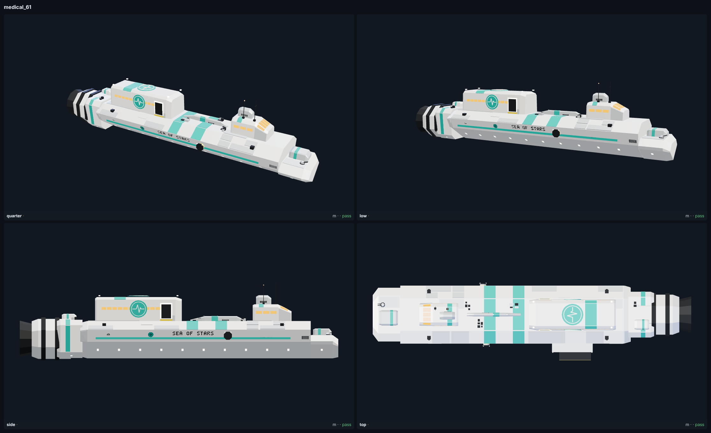

### Raiders (v0.16.0)

`--archetype raider`: ordinary hulls (block, barge, twin) that pirates rebuilt. A kitbash pass adds ram spikes
jutting from the bow, scavenged junk welded on at odd angles (crates, tanks), rusty patch plates bolted over the
flanks, tattered sails on a mast with a yard, and extra welded-on guns; raiders are more often asymmetric and mostly
wear the pirate scheme (mismatched plates). A new faction, `raiders` (Free Raiders of the Drift, registrations
`RDR-…`), fields them with escorting fighters.

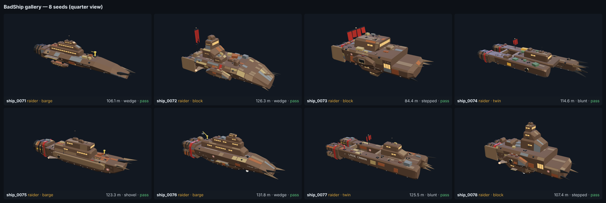

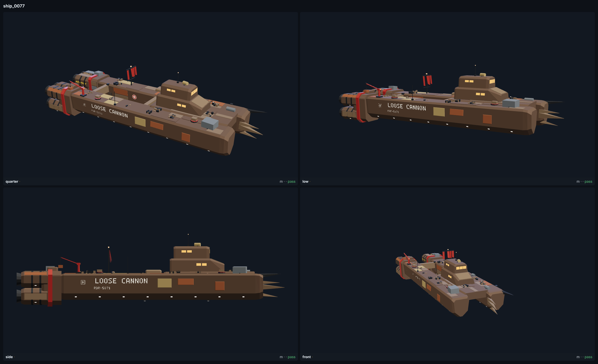

### The warship ladder (v0.17.0)

`--archetype warship` (`--set payload=...`): `corvette` (60–90 m, one turret), `frigate` (90–150 m, two),
`destroyer` (150–220 m, three, raised ones firing over the others), `cruiser` (220–320 m, four or five) and
`carrier` (300–450 m). Combatants carry gun turrets (two or three barrels, facing bow or stern) sitting down into
the hull's shoulders, missile cell grids (`missile_cells` markers), the bridge amidships, point defence, sensors and
antennas. The carrier has an overhanging flight deck on struts with a dashed centre line, edge lines, an angled
landing lane and an elevator, a lit hangar mouth at the bow (`hangar`, `launch_lane` and `elevator` markers), and its
island bridge on the starboard edge. Warships mostly wear the military scheme; the Frontier Patrol fields them.

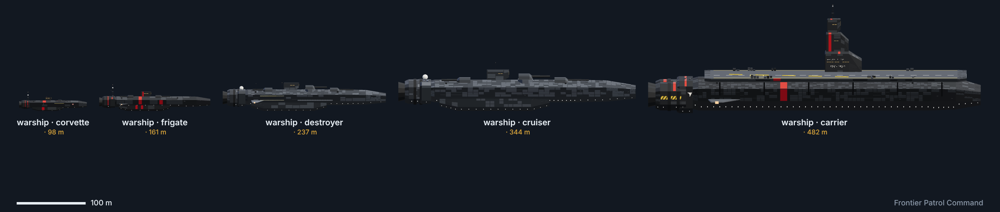

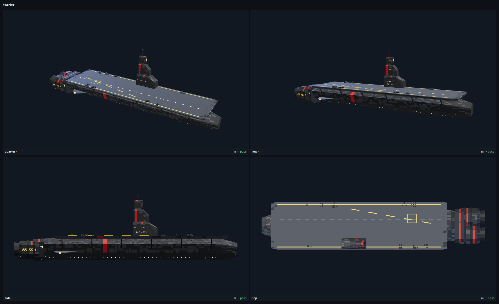

### Interiors (v0.18.0)

`generate --interior` also writes a walkable interior that fits inside the hull:

- `name.interior.glb`: the geometry, in the ship's coordinates so it lines up with the exterior. One node per deck
  (floor, walls, stairs), a roof over the top deck, **one node per door** (type `door`, with its rooms, size,
  `slide_axis` and `opens: slide` in the extras), and **one empty node per room** at its centre (type `room`, with
  its kind, deck and box in the extras). Markers: `door`, `airlock`, `room`, `spawn`.
- `name.interior.json`: decks, rooms, doors, stairs and the interior validation report.
- `name.interior.deck_N.glb`: each deck without the roof, for previews.

The longest constant section of the main hull is filled with a stack of decks (3.4 m apart, 3.1 m clear), each as
wide as the hull allows at both its floor and ceiling. A deck has a central corridor with rooms on both sides and
cross-corridors every 24–32 m; the bridge spans the front of the top deck and engineering the back of the lowest; a
freighter's lowest deck is one big cargo hold; a stairwell at the same place on every deck carries ship's stairs
(open above the flight, landings at both ends, a walkway beside it); airlocks open in the hull wall. Rooms come from
the ship type (crew quarters, mess, medbay, labs, armoury, brig, passenger cabins, lounges, workshops, reactor...)
with command rooms up top and machinery low, and floors tinted by zone (command, crew, work, cargo, medical).
Narrow small craft get one deck of rooms in a row. No furniture: rooms, walls, doors, stairs and lights.

The interior validator checks that every room is reachable from the airlock through doors and stairs, that rooms sit
inside the hull, that doors join real rooms and that rooms do not overlap; `stress --interior` runs it (0 errors over
1000 ships). **In Godot:** `tools/godot-interior/` has `door.gd` (a sliding door that reads its size and axis from the
extras and opens when someone walks up; outer airlock doors wait for `open()`), `interior_setup.gd` (gives every
`door` node the script and walls, floors and stairs collision; also usable as an import script via `post_import.gd`)
and `run.sh`, which loads an interior headless, opens and closes a door, bakes a navigation mesh and walks from the
spawn point to every room (see v0.20.0 for what made that reliable). The Shipyard has an **Exterior / Interior**
switch with deck buttons.

Not yet: furniture and a BadLevel export.

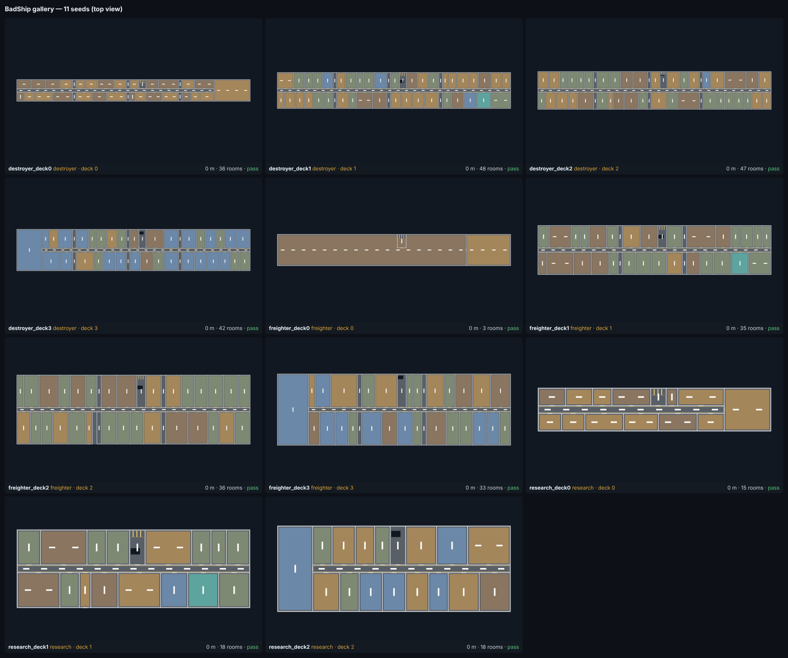

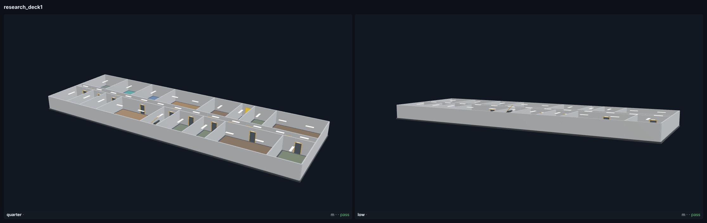

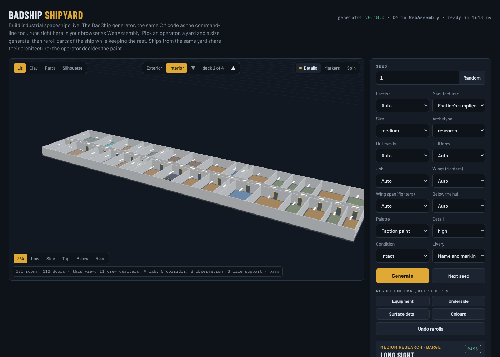

### Windows (v0.19.0)

With `--interior` (recipe `"interior": true`, code key `1y`), the interior is planned right after the hull masses
and rooms along the hull walls (cabins, mess, bridge, lounges, medbay, corridor ends) get **real windows**: each is
cut as an opening through the hull (where one of its side faces covers the window's height and nothing stands
outside), with a see-through, double-sided glass pane (`window_glass`, glTF BLEND) and a reveal (the short tunnel
through the hull to the interior wall), and a matching opening in the interior's wall. The windows reserve their
patch of hull first, so plates, markings, kit and damage stay off them. People inside can be seen from outside.
`window` markers on the exterior; `windows` in the interior JSON. `name.ship_and_interior.glb` puts exterior and
interior in one file, lined up; `tools/render/windowview.mjs` looks through a window from outside and inside.
The Shipyard has a **Windows** chip (on automatically in the Interior view). Without the option, ships are as before.

In an engine, keep players inside off the exterior's convex collision pieces (use the interior's collision and a
separate physics layer), since the convex pieces enclose the interior.

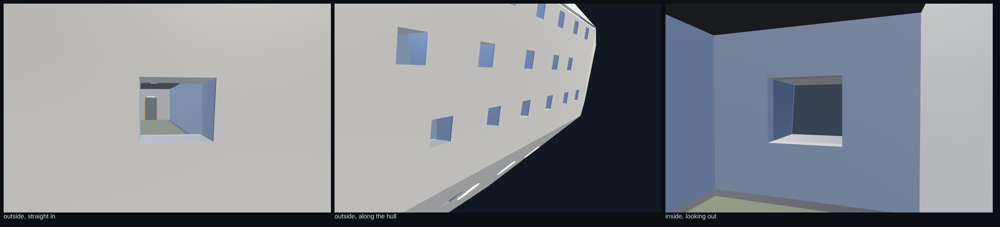

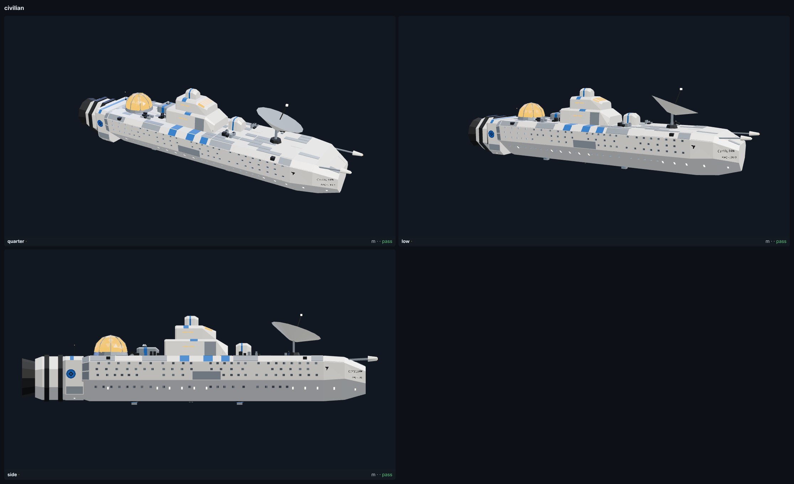

### Complex interiors (v0.20.0)

Bigger ships no longer get the same corridor on every deck:

- **Halls two decks tall**: an atrium (liners, research and ring ships), a hangar (warships, patrols, citadels) or a
  cargo bay (freighters, industrial ships, raiders) on a pair of wide decks, low in working ships and mid-ship in the
  rest. On the deck above, a **gallery** walkway runs round the void over the hall, with railings, and a **grand
  staircase** rises from the hall floor to it. Rooms on both decks open onto the hall and the gallery.
- **Ring corridors**: on other wide decks, the corridor splits round a central room (a lounge, lab, operations room
  or commons) with doors on both lanes, and rooms outside the ring open onto it.
- **Suites**: deep rooms become a pair, the front one on the corridor and a second one behind it against the hull:
  medbay and ward, lab and clean room, the captain's office and cabin, mess and galley, briefing and comms, and now and
  then a cabin with its own lounge, quarters with a bunk room, a workshop or armoury with its store.
- **Stairwells** are as wide as their deck allows, up to 6 m, with a store beyond them on wide decks.

The interior JSON marks a hall's two-deck height in its box (and `decks: 2` in the room node's extras), and the grand
staircase in `stairs` has `to_room` (the gallery). `tools/render/hallview.mjs` looks round a hall and a ring.

Doors are now 1.4 m wide (they were 1.2 m). With a 0.35 m agent radius, Godot's navigation baking kept only half a
metre of a 1.2 m door, which at a 0.2 m cell sometimes rounded to nothing: one room per big ship was unreachable.
Flights of stairs also step sideways on tapering hulls instead of stacking exactly in a narrow shaft, which confused
the baker. The Godot walk test (`tools/godot-interior/run.sh`) now reaches every room of every test ship, citadels
with 1,600 rooms included.

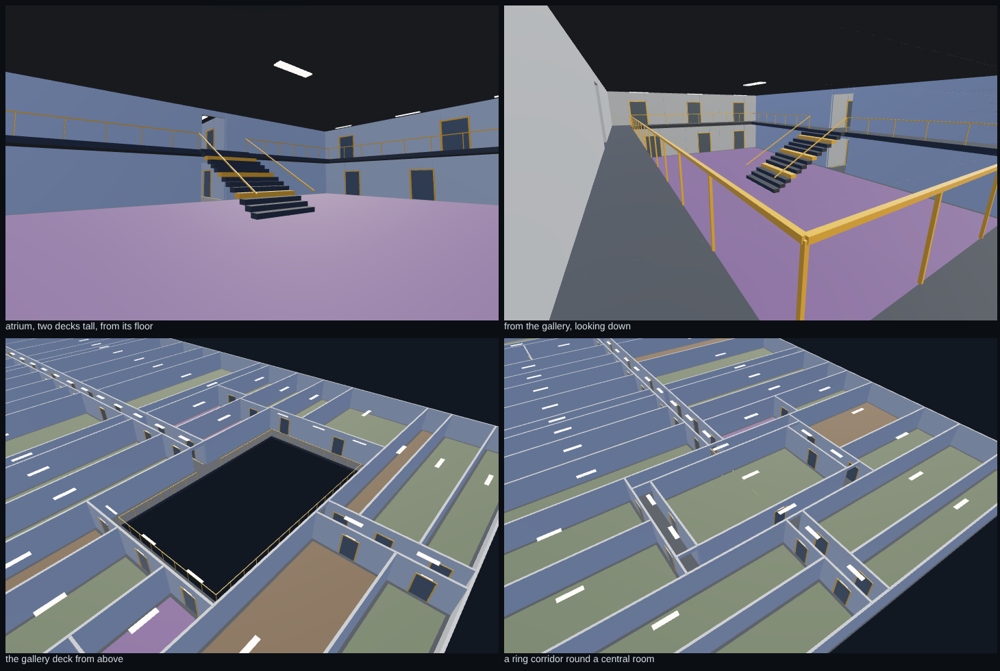

### Superstructure and keel decks, ladders and elevators (v0.21.0)

Interiors now go beyond the main hull:

- **Superstructure decks**: every centred block on top of the hull (the bridge block and superstructure tiers) gets
  a deck in its longest constant section, with command and crew rooms (observation, comms, briefing, the captain's
  cabin...). A tier stacked on another gets its own deck, above the one below.
- **Keel decks**: a keel under the hull gets a deck right under the lowest hull deck, with stores and workshops. It
  reaches up into the bottom of the hull, so the keel's width counts below its top and the hull's above it.
- Decks outside the hull may have a lower ceiling (2.6–3.1 m) to fit a smaller block. Decks are numbered from the
  bottom up, and each says which part it is in (`part`: `hull`, `superstructure` or `keel`).
- **Stairs or ladders** join each of those decks to the deck under (or over) it: stairs where both decks are wide
  enough and the rise is about a storey, otherwise a **ladder** through a hatch with a rail round it. On a hull deck
  the link gets its own stair hall or ladder room across the deck; a shaft closes the gap between the two decks.
- **Elevators**: ships with three or more hull decks (half of the three-deck ones) get an elevator: a shaft against
  the hull beside a lobby off the corridor on every deck (on a freighter's hold deck it opens into the hold), a car at
  the lowest stop, and an **elevator door** at every stop.

The interior JSON has `lifts` (ladders and elevators: decks, rooms, shaft, access points, doors). In the GLB, ladders
and elevator cars are nodes of type `ladder` and `elevator` with the same in their extras (`stops_y`, `access`,
`doors`, `top`, `bottom`). **In Godot**, `interior_setup.gd` now gives elevator cars `elevator.gd` (call `call_to(i)`:
it closes the door, rides, and opens the door at the new stop; elevator doors never open by themselves) and adds
`NavigationLink3D` nodes over every ladder and between elevator stops, so navigation agents path across them; how a
character climbs or rides is up to the game. `tools/render/liftview.mjs` shows the deck stack, a ladder and the
elevator (cut open with the renderer's new `clip` option). `badship stress --interior --verbose` names failing seeds.

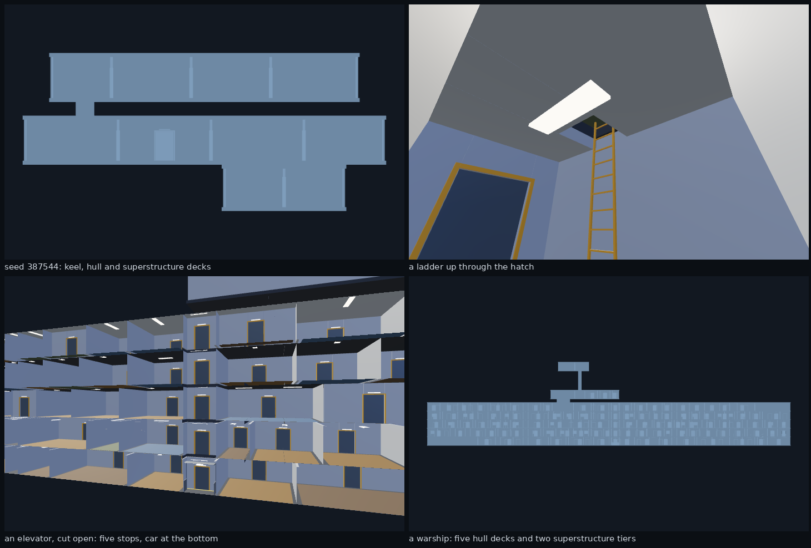

### Gondola decks (v0.22.0)

With an interior, a **gondola** (the pod hanging on pylons under the hull) gets a deck too, where the pod is widest:
observation rooms and labs on research and ring ships, lounges on liners, cargo on freighters. A **ladder** climbs
from it into the lowest hull deck inside an **access trunk**: a ribbed, boxed tube on the outside, from inside the
gondola up into the hull, built where the interior puts the ladder. Gondolas on interior ships are made big enough to
stand in (at least 4.8 m tall, up to 7 m wide and 16 m long, as the hull allows); ships without an interior keep
their gondolas as before, with no trunk. On a hull deck, a ladder may also stand inside engineering, the bridge or one
of a small craft's rooms, clear of their doors, instead of in a ladder room of its own.

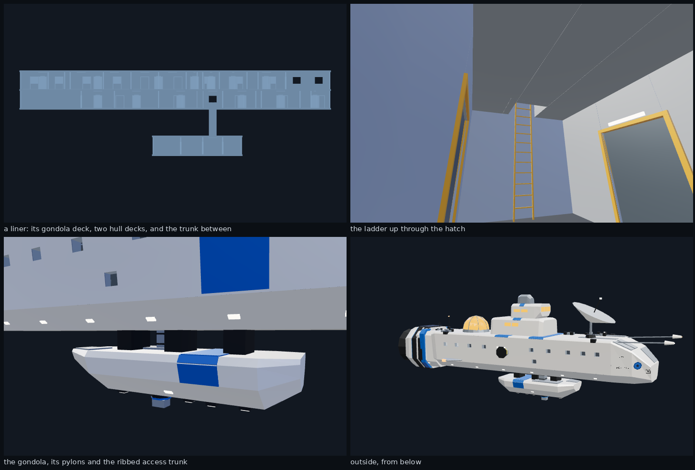

### Bridge block decks (v0.23.0)

Superstructure and bridge blocks off the centreline get decks too (a deck has a `cx`, its centre across the ship),
a block's deck may be as low as 2.5 m clear, and it reaches on into the block's tapered ends as far as it still fits
(`Loft`-section test), so a **bridge block's deck ends in a bridge** across the front. Ladders and stairs stand where
the two decks overlap across the ship.

### Hull-shaped block decks (v0.24.0)

A block deck with nothing stacked on it now follows the block's own shape instead of being a box (`shaped` in the
JSON). Its **inner skin** is the block's cross-section moved 0.3 m inward, clipped to the band between floor and
ceiling: it is the outer wall, slants across the upper corners along the block's chamfers, and comes down with the
ceiling under sloped or tapered ends. Floors stay flat and walls between rooms stay straight (people and navigation
meshes need both), but their tops and outer ends follow the skin. Only the band people walk in (floor to a little over
door height) has to fit, so shaped decks are wider and reach further into the block's ends. Code in
`Interior/Skin.cs`; the skin is a double-sided `interior_skin` material, and its overhead parts are in the deck's
`ceiling` node (hidden when you look in from above).

### Real windows in block decks (v0.25.0)

Glass drawn on any loft is now remembered (`Loft.Panes`). In a shaped block deck, the block's own panes over a room
become **real windows**: the block's loft is rebuilt with the openings, the pane's glass turns see-through
(`window_glass`), a reveal joins the opening to a matching hole in the deck's inner skin, and the window is listed in
the interior JSON with its block, face and rectangle (`module`, `s`, `f`, `u0`–`v1`; `side` 0 for overhead glass).
Side windows, chamfer panes and **sloped windscreens** all work: a bridge at the front of a shaped deck opens forward
into a low **nose nook** under the block's sloped front (too low to walk in, room to look out), so the windscreen over
it is a window you can see the stars through.

v0.25.1: a face that is not quite flat is split into two triangles along whichever diagonal keeps it bulging
outward (it used to be the same diagonal every time, so mirrored faces dented in on one side of the ship).

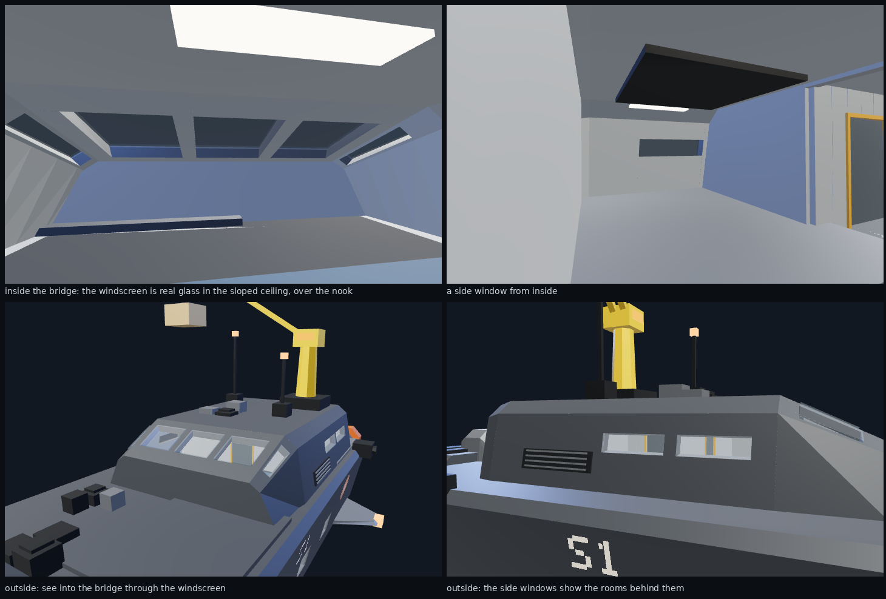

### Shaped stacked blocks and gondolas (v0.26.0)

Every block deck is shaped now, lower tiers in a stack included: the skin's flat ceiling has openings where a ladder
or stairs go up, with a shaft through any gap to the deck above. A **gondola** deck is shaped to its pod too, and
its glass becomes real windows; on interior ships a research gondola's observation band runs round its sides at eye
level (instead of its lower facets), so the lounge inside looks out through it.

### Shaped hull decks and one window system (v0.27.0)

The main hull's decks follow the hull too. Each is as wide as its walking band allows and reaches into the nose and
tail as far as that band fits; in a stack, a deck's skin reaches up to the next floor, whose underside is its ceiling
(the top deck has a flat ceiling), with openings for the stairs, the hall voids and the elevator. An outer airlock
door keeps a framed wall section in the skin. Below the bridge, a deck with glass in the nose ahead of it ends in an
**observation** room that opens into a low nook under that glass.

All real windows now go through one system, for every part (hull, blocks, gondola): a window is a rectangle on a
face of the part's loft, either **cut in** (the hull's window placement) or **converted** from glass the part already
had (`painted` in the JSON; only the part of a pane a deck can see is opened). Each part's loft is rebuilt once with
all its openings, converted glass turns see-through, new openings get a pane, and every window gets a reveal to the
deck's skin. Liners' window bands, the faceted prow glass and small craft cab windows all became real this way.

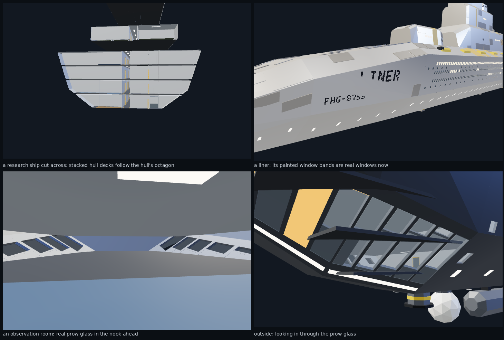

## Devlog

[The BadShip Shipyard Log](docs/devlog/index.html) tells the story of each launch, the fun way. The
`Devlog on GitHub Pages` workflow (`.github/workflows/pages.yml`) publishes it on every push to `main` that touches it
(or by hand from the Actions tab): set the repository's Settings → Pages → Source to "GitHub Actions" once. Only the
devlog, the images it uses and a front-page redirect go online.

## Status (v0.27.0: shaped hull decks, one window system)

- Citadels (flying fortresses, 3 prows × 2 keep positions × 3 undersides × keep tiers × nozzle grids).
- Fighters and gunships (7 forms × 3 noses × a bulk dial × 8 wing styles × a span dial × 3 sizes) in a stealth "badlook" language; 0 validation errors over 3000+ seeds
  (intact, damaged and derelict), about 1–1.5k triangles each.

- 4 hull families × 3 archetypes × 2 hull forms, 5 prow styles, 3 bridge styles, 5 engine layouts, 2 engine styles, 4 palettes.
- Open hangar bays (lit alcove with depth, gantry, hazard sill, vehicle or crates, railed platform) built from
  closed boxes, plus flat cargo doors where a hangar doesn't fit.
- Ventral structures (keel, gondola, slung pods) and underside equipment.
- Manufacturer design languages, factions, size classes, `fleet` command and true-scale lineups.
- Ship codes (shareable links) with versioned generator snapshots in the Shipyard.
- Godot 4.4.1 import verification (editor import and runtime GLTFDocument), with an in-engine render.
- Damaged and derelict conditions that keep the ship's identity; Godot imports them cleanly (12/12).
- Livery: names, registrations, emblems, yard marks and chevrons as an embedded decal texture (optional); textures
  pass the Khronos validator and arrive in Godot as alpha-scissor albedo textures.
- 1000 seeds per size class: 0 validation errors (a handful of small craft warn that they ended up a little longer
  than planned); about 3 / 7 / 13 ms and 2k / 5.4k / 9.8k triangles for small / medium / large ships.
- Exports pass the Khronos glTF validator with 0 errors and 0 warnings (infos only: UVs unused without textures).
- 48 unit tests: determinism, stage independence, validation over hundreds of seeds, recipe round trip, GLB structure.

- Stage rerolls (`--stage-seed`, `variants`), plan overrides (`--set`), LOD1/LOD2 and convex collision exports.

**Verified in an engine:** Godot 4.4.1 imports and loads the ships, LODs and collision cleanly (see above); Blender,
Unity and Unreal have not been tested yet.

**Known limitations:** clearance tests use bounding boxes (conservative); non-lofted parts (cranes, masts) get one
box each in the collision file; LODs remove whole modules rather than simplifying meshes; textures only for livery (hull materials are plain colours by role); no interactive editor (CLI +
renders only); locking works per stage, not per individual module yet.

**Next (phase B/C ideas):** a viewer with parameter
controls; per-module locking;
more archetypes (mining, tender) and macro families (offset hauler, multi-deck brick); radiators, booms and gantries;
a damage pass; and then the self-contained NoorShip design doc for NoorMD.

## Layout

```text
src/BadShip.Core/     Geometry (Mesh, Profile/Loft, Shapes), Model (Ship, Module, Marker),
                      Generation (Planner, HullFamilies, Parts, Payload, Equipment, Details, Palette, Rng),
                      Validation (ShipValidator), Export (GlbWriter, ShipFiles)
src/BadShip.Cli/      the badship command
src/BadShip.Web/      the generator compiled to WebAssembly (JSExport API: Generate, LastInfo, Version)
tests/BadShip.Tests/  xUnit tests
tools/render/         three.js + Playwright contact sheets and close-ups
tools/glb-validate/   Khronos glTF validator runner
tools/hangar/         interactive 3D gallery page builder
tools/shipyard/       the live generator page and its build script
tools/godot-test/     Godot 4 project that imports and verifies exports (run.sh, verify.gd, showcase.gd)
docs/brief/           the original handoff package
```
